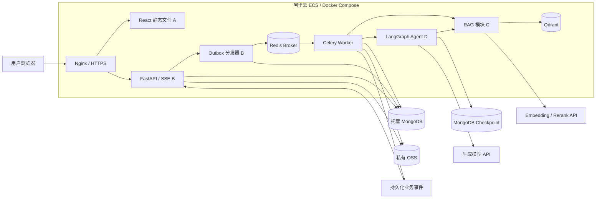

# CareerPilot 技术架构

状态：v0.3 技术设计与 M1 契约候选版。开发骨架已建立，业务闭环与云端部署尚未完成；运行和已实现边界见 [09 本地启动指南](09-本地开发启动-local-setup.md)。负责人拥有架构决策权；各成员记录变更理由、影响和迁移方式。

## M1 必要子集

本篇表格和系统图描述总体目标。首轮只连接 React/TS、FastAPI/Pydantic、MongoDB、最小 Celery/Redis、LangGraph 基本流程、Embedding 与 Qdrant 向量检索。文件使用本地私有目录，前端通过任务查询轮询；只处理 Markdown/TXT 和个人经历证据，缺失信息写入结果，不触发 interrupt。

OSS、PDF、混合检索、Rerank、SSE、持久化用户恢复与完整 Outbox 补偿在 M2，计划和面试按 PRD 阶段推进。M1 的 Celery 发布失败必须转为可查询错误，但不宣称已具备完整的跨进程可靠性。完整规范属于后续交付目标，不能要求 A–D 在首轮同时完成所有组件。样例与任务见 [examples](../examples/README.md) 和 [M1 开工计划](08-M1开工计划-kickoff-plan.md)。

## 建议技术方案

| 层次 | 建议方案 | 决策理由及待验证项 |
| --- | --- | --- |
| Web 前端 | React + TypeScript + SSE | 展示工具执行进度、补充信息请求和结果；SSE 断开后通过事件回放及任务查询恢复 |
| 业务 API | Python + FastAPI + Pydantic | 与 RAG、Agent 共享语言；明确输入输出类型、用户权限及幂等边界 |
| Agent 编排 | LangGraph + Tool Calling + 持久化 Checkpoint | 表达岗位分析、资料追问、计划确认与恢复；单 Agent，不另建多 Agent 集群 |
| RAG 检索 | Qdrant + 稠密/关键词混合检索 + Rerank | 先建立向量检索基线，再实测混合检索和重排序收益；按用户、版本过滤 |
| 应用数据 | 托管 MongoDB 副本集 | 保存业务记录和执行状态，支持计划确认事务；优先验证同地域阿里云 MongoDB 实例 |
| 后台任务 | Celery + Redis Broker | 分发解析、索引及 Agent 执行任务；MongoDB 保留权威状态，Redis 不承担业务主库职责 |
| 文件存储 | 阿里云 OSS 私有 Bucket | 保存原文件及版本化解析文本；本地适配器使用被忽略的目录 |
| 模型服务 | 独立的生成、Embedding、Rerank Provider 适配器 | 三类服务可分别替换；通过 API 调用，初期 ECS 不承载本地大模型推理 |
| 部署 | 阿里云 ECS + Docker Compose + Nginx/HTTPS | Nginx 提供前端静态文件及 API 反向代理，ECS 运行 API、Worker、Redis、Qdrant 等服务 |
| 持续集成与发布 | GitHub Actions 检查与构建；负责人手动触发 ECS 发布 | 已添加 PR 检查、本地依赖连接验证和前端构建；main 镜像与 ECS 发布待实现 |
| 评测与观察 | 固定验收集、结构化运行事件；Langfuse 为可选接入 | 跟踪证据、工具调用、耗时和用量；对外追踪默认不发送个人简历或回答正文 |

使用一个 Python 代码库划分业务、Agent、RAG、Worker 和任务分发模块，不按模块建立微服务。先完成核心流程，再补齐队列恢复、混合检索、SSE 与发布能力；部署和组件引入顺序见 05。版本与资源规格须通过原型验证后锁定，当前不承诺费用和性能数字。

M1 真实数据流：A 上传/导入 → B 保存元数据并创建任务 → C 入库/检索或 D 执行分析 → B 校验并保存结果 → A 查询与展示。C 的入库工具不依赖前端；D 不直接写 API 资源；B 不自行重新实现检索和 Agent 判定。

## 系统边界



图中 Checkpoint 与业务数据可位于同一托管 MongoDB 实例的独立逻辑库；不是必须另购一个实例。业务事件保存在 MongoDB，图中单列用于说明 SSE 的读取来源。前端访问同域 `/api/v1`，避免在浏览器暴露数据库和模型服务地址。

## Qdrant 在 RAG 中的作用

Qdrant 是向量检索引擎：保存文档片段对应的向量和元数据，返回与查询相关的候选片段。Embedding 模型负责将文本转成向量，Rerank 模型对候选片段重新排序，生成模型结合检索证据作答。Qdrant 不替代这三类模型。

| 组件 | 保存或处理的内容 | 项目示例 |
| --- | --- | --- |
| MongoDB | 权威业务数据、可引用片段、任务、计划、文档版本与原文位置 | 某用户的分析结果和计划状态 |
| 私有 OSS | 原始简历、项目说明、版本化解析文本 | resume.pdf 及提取文本对象 |
| Qdrant | 稠密向量、关键词稀疏表示及片段元数据，可重建 | chunk_id、user_id、document_id、version、corpus |
| Embedding / Rerank / 生成模型 | 转换向量、候选排序、基于证据生成结论 | 从经历中检索相关片段，再核对是否支持 JD 要求 |

例如，岗位写“后端性能优化”，项目资料写“使用 Redis 缓存热门查询”。检索可找到相关候选经历；Agent 仍需核对原文，不能仅凭向量相似度断言用户具备该能力。

文档入库流程：解析 → 切分 → 记录来源位置 → 生成 Embedding 与关键词索引 → 写入 Qdrant → 发布可检索版本。查询流程：构造查询 → 权限/版本过滤 → 稠密与关键词召回 → RRF 融合 → 可选 Rerank → 取原文证据 → 生成引用答案。个人经历和公共面试知识分别检索，不能混作个人能力证据。

先比较向量基线、混合检索、混合检索加 Rerank 的效果与耗时，再决定默认启用策略。模型、切分参数和检索配置随评测记录版本；Milvus 可作为未来适配器选项，本期不同时维护两套向量库。

## 两条数据流

### 资料入库

API 验证文件与用户 → 写入私有 OSS → MongoDB 创建 documents、executions 和待分发记录 → Celery/Redis 分发 → C 解析、切分和建立索引 → 标记 ready。只有全部成功的版本才可检索。重试按文档 ID 与版本幂等更新片段和向量；删除先阻断查询，再异步清理 OSS、片段及 Qdrant 副本。

### 分析与计划

API 验证用户和资料版本 → 创建分析任务 → Celery Worker 启动 LangGraph → 拆解 JD → C 检索 → 校验证据 → 输出结构化分析。资料缺失时可通过 interrupt 暂停，由用户补充后恢复；用户也可选择保留“资料未体现”的结论继续。

计划生成使用独立执行任务：生成并保存 draft → interrupt 等待确认 → API 验证约束和版本 → 事务性创建正式任务、确认计划并记录恢复指令 → 恢复图执行并完成。计划确认后的重试不得重复创建任务。Agent 只通过白名单工具和业务服务操作，不直接执行任意数据库命令。

LangGraph 使用持久化 Checkpoint；先验证 MongoDBSaver 与选定实例、驱动版本的兼容性。thread_id 由服务端生成并绑定用户和 execution，前端不能任意指定图线程。等待用户时释放 Worker，不占用一个 Celery 进程持续等待。

## 队列、状态和实时事件

- MongoDB executions 是任务状态权威来源，Celery task_id 只标识投递。前端不直接把 Celery SUCCESS 当作业务完成。
- 任务记录与 dispatch_events 在同一事务中写入；分发器将待分发指令送到 Redis，记录发布结果，失败可重试。它只负责投递，不恢复旧版“MongoDB 领取任务执行”的并行调度方式。
- 队列按至少一次投递设计。Worker 通过 execution_id、dispatch_id 和状态版本认领执行；已处理指令直接返回，索引及确认工具幂等。重复的外部模型调用仍可能发生，不能宣称 exactly-once。
- Worker 使用限时运行租约，重启后由恢复流程重新分发过期运行指令；Celery 确认和 Redis 可见性超时必须按实际任务上限联调验证。
- 业务事件在 MongoDB 持久化后通过 SSE 发给前端。断线通过 after_event_id 回放，必要时查询任务快照；Redis Pub/Sub 不能作为唯一进度来源。
- SSE 使用支持 Authorization 请求头的 fetch 流；不把令牌放进 URL。P0 传输阶段进度、等待输入和最终状态，token 级输出可后续扩展，不展示隐藏推理过程。

## C 与 D 的内部契约

以下为语言无关的逻辑接口，具体类型定义由对应成员维护在代码库公共契约模块。

```text
retrieve_evidence(user_id, query, corpus, document_versions, top_k)
  -> {evidence: [{chunk_id, document_id, version, locator, quote,
                  source_type, retrieval_score}], retrieval_config_version,
     warnings: []}

run_analysis(user_id, job_id, document_versions)
  -> {requirements: [{id, text, category, status,
                      evidence_ids, explanation, missing_information}],
      warnings: [], trace_id}
  或暂停为 waiting_for_input（继续接口见 04）

generate_plan(user_id, analysis_id, deadline, timezone, daily_minutes)
  -> {tasks: [{title, requirement_ids, scheduled_date,
               estimated_minutes, source_ids}], warnings: []}
```

- corpus 仅允许 personal 或 public；公共知识不能用作用户个人经历的证据。
- user_id 来自认证上下文，不信任前端或模型提供的身份。
- locator 为结构化位置：PDF 页码或文本行号范围；解析阶段无法定位时，必须明确标记，不能捏造页码。
- retrieval_score 仅用于检索排序，不作为“求职成功概率”或能力分数展示。
- evidence_ids 只能引用本次实际检索返回的条目，保存前再次验证所有权、版本和未删除状态。

M1 中 retrieve_evidence 的 corpus 固定 personal，默认只用向量检索；公开 JSON fixture 和答案不参与索引。D 返回内部 requirements/evidence_ids 后，B 保存 requirement_snapshot，按本次工具返回的元数据转换为公开 API 的 matches/evidence_refs，并补齐 requirement 文本和 category。supported/partial 必须有真实证据，not_evidenced 的引用为空；UI 不从不稳定的解释文字中推断状态。

## 执行状态与预算

- 任务：queued → running → succeeded / failed；需要用户补充或确认时 running → waiting_for_input → queued → running。等待状态不是成功或失败。
- 每次领取设置 worker_id、lease_until 和状态版本；设计初值最多 2 次技术重试。用户正常恢复不消耗技术重试次数。
- Agent 每个任务累计最多 8 轮工具调用，单工具超时 30 秒，累计活跃执行时限 180 秒；用户等待时间不计入执行时限，恢复不会重置预算。实际参数由原型验证后调整。
- 仅对超时、限流等可恢复错误重试；鉴权、无效输入及越权请求立即失败。
- 保存工具名称、状态、耗时、引用 ID、提示词版本和用量摘要，不保存模型隐藏推理过程。
- P0 先提供固定评测集和业务事件记录；Langfuse 是后续可选观测接入，默认关闭外部正文上传，先对合成资料验证再决定启用。

## 数据与权限

业务 API 和检索层都强制用户范围过滤。下载原文件须鉴权或使用短时签名 URL。个人数据更新会生成新版本；已有分析保留引用版本并显示 stale。删除先使所有查询不可见，再清理原文件、片段和向量。索引副本不是资料生命周期的权威来源。

向量检索时按用户、文档、版本与删除状态过滤；不得先全库取结果再在前端过滤。删除流程对失败任务持续重试，并在验收中检查已删除资料不会被检索。

## 接口与变更

公共 API：见 04。应用数据：见 03。部署：见 05。Schema、鉴权、工具或索引格式变更应写明兼容性，并由负责人审查；模型与嵌入版本改变需要检查旧索引兼容性。

## 官方技术参考

- [阿里云 ECS 安装 Docker 与使用 Compose](https://help.aliyun.com/zh/ecs/user-guide/install-and-use-docker)
- [Docker Compose 单服务器部署](https://docs.docker.com/compose/how-tos/production/)
- [Qdrant 混合检索与重排序](https://qdrant.tech/documentation/tutorials-basics/reranking-hybrid-search/)
- [LangGraph 用户介入与恢复](https://docs.langchain.com/oss/python/langgraph/interrupts)
- [MongoDB 与 LangGraph 集成](https://www.mongodb.com/docs/atlas/ai-integrations/langgraph/)
- [Celery 使用 Redis](https://docs.celeryq.dev/en/stable/getting-started/backends-and-brokers/redis.html)
