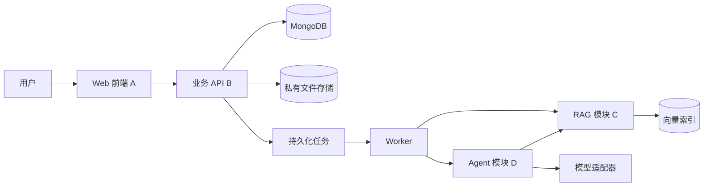

# CareerPilot 技术架构

状态：v0.1 建议初稿，尚未完成选型验证或实现。负责人拥有架构决策权；各成员通过 Issue 提交变更理由、影响和迁移方式。

## 建议技术方案

| 层次 | 建议方案 | 决策理由及待验证项 |
| --- | --- | --- |
| Web 前端 | React + TypeScript | 类型化接口与组件复用；版本在搭建时锁定 |
| 业务 API | Python + FastAPI | 与文档解析及 Agent 模块共享语言，减少跨服务联调 |
| 应用数据 | MongoDB 托管实例 | 保存用户、文档元数据、JD、任务、计划及面试；符合课程托管 NoSQL 方向 |
| 向量索引 | Qdrant，经独立适配器访问 | 与业务数据库分离；先验证托管或容器运行、过滤能力和删除同步 |
| 文件存储 | 私有对象存储；本地开发使用被忽略的目录 | 原文件不进入代码仓库，不通过公开静态目录暴露 |
| 模型与嵌入 | 可替换 Provider 适配器 | 模型、维度、用量与地域可用性由原型验证，密钥只在服务端 |
| 部署 | 前端静态托管 + API/Worker 容器 | 负责人验证 HTTPS、私有存储、数据库和索引连通性 |

初期使用一个 Python 代码库划分业务、Agent、RAG、Worker 模块，不把每个模块拆成微服务。异步任务数据保存在 MongoDB；API 负责创建任务，Worker 使用原子状态更新领取任务，避免仅依赖进程内后台任务造成重启丢失。

## 系统边界



## 两条数据流

### 资料入库

API 验证文件与用户 → 私有存储 → documents 记录 → 索引任务 → C 解析和切分 → 写入可引用片段及向量 → 标记 ready。只有全部成功的版本才可检索。失败标记原因，保留可重试状态；删除使用 deleted_at 先阻断访问，再清理副本。

### 分析与计划

API 验证用户和资料版本 → 创建分析任务 → D 拆解 JD → C 检索个人经历及公共知识 → D 生成结构化匹配结果 → 校验证据 ID 和版本 → 保存分析。计划生成使用独立异步任务；用户确认后由 API 事务性地创建计划任务。Agent 不直接执行任意数据库操作。

## C 与 D 的内部契约

以下为语言无关的逻辑接口，具体类型定义由对应成员维护在代码库公共契约模块。

```text
retrieve_evidence(user_id, query, corpus, document_versions, top_k)
  -> {evidence: [{chunk_id, document_id, version, locator, quote,
                  source_type, retrieval_score}], warnings: []}

run_analysis(user_id, job_id, document_versions)
  -> {requirements: [{id, text, category, status,
                      evidence_ids, explanation, missing_information}],
      warnings: [], trace_id}

generate_plan(user_id, analysis_id, deadline, timezone, daily_minutes)
  -> {tasks: [{title, requirement_ids, scheduled_date,
               estimated_minutes, source_ids}], warnings: []}
```

- corpus 仅允许 personal 或 public；公共知识不能用作用户个人经历的证据。
- user_id 来自认证上下文，不信任前端或模型提供的身份。
- locator 为结构化位置：PDF 页码或文本行号范围；解析阶段无法定位时，必须明确标记，不能捏造页码。
- retrieval_score 仅用于检索排序，不作为“求职成功概率”或能力分数展示。
- evidence_ids 只能引用本次实际检索返回的条目，保存前再次验证所有权、版本和未删除状态。

## 执行状态与预算

- 任务：queued → running → succeeded / failed；达到上限返回明确错误，不伪装为成功。
- Worker 领取任务设置 lease_until 和 worker_id，过期任务可重领；以 attempts 限制重试，设计初值为 2 次领取。
- Agent 每个分析任务最多 8 轮工具调用，单工具超时 30 秒，总时限 180 秒；这是初始配置，变更需记录实测依据。
- 仅对超时、限流等可恢复错误重试；鉴权、无效输入及越权请求立即失败。
- 保存工具名称、状态、耗时、引用 ID、提示词版本和用量摘要，不保存模型隐藏推理过程。

## 数据与权限

业务 API 和检索层都强制用户范围过滤。下载原文件须鉴权或使用短时签名 URL。个人数据更新会生成新版本；已有分析保留引用版本并显示 stale。删除先使所有查询不可见，再清理原文件、片段和向量。索引副本不是资料生命周期的权威来源。

向量检索时按用户、文档、版本与删除状态过滤；不得先全库取结果再在前端过滤。删除流程对失败任务持续重试，并在验收中检查已删除资料不会被检索。

## 接口与变更

公共 API：见 04。应用数据：见 03。部署：见 05。Schema、鉴权、工具或索引格式变更应写明兼容性，并由负责人审查；模型与嵌入版本改变需要检查旧索引兼容性。
