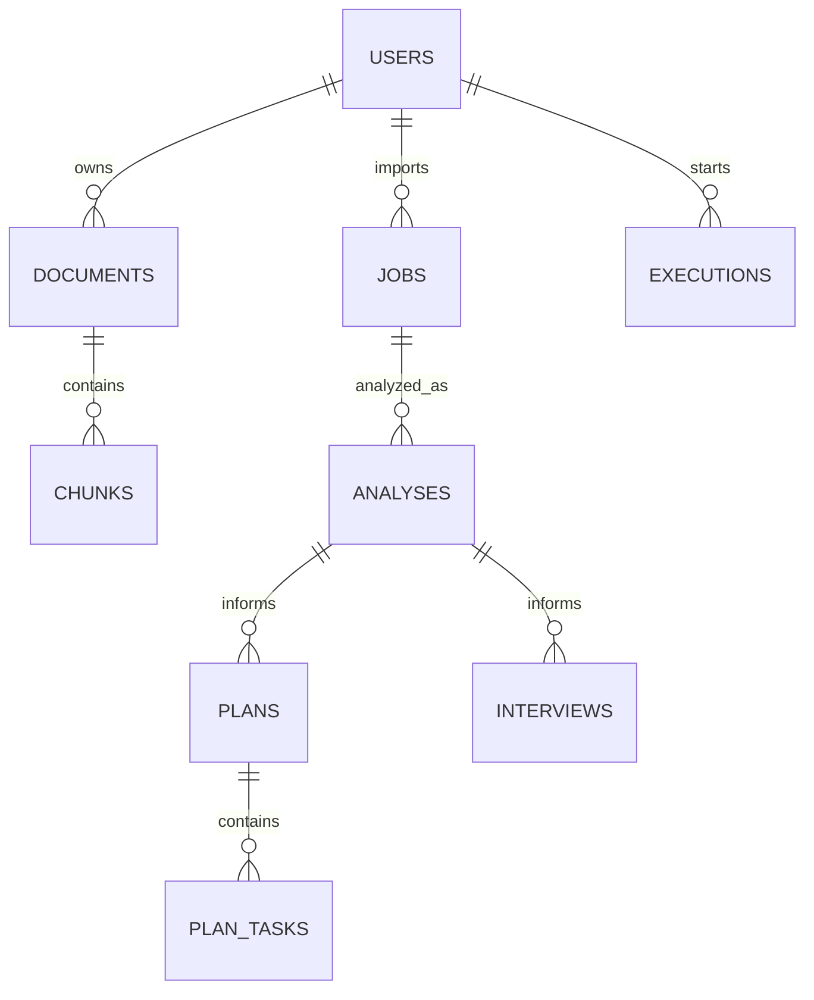

# CareerPilot 数据库设计

状态：v0.4 设计草案与 M1 契约候选版。负责人维护逻辑设计，B 实现业务集合，C 实现片段及 Qdrant 映射，D 与 B 约定分析结构。当前未创建生产数据库。

## M1 数据范围

首轮只需要 users、documents、document_versions、chunks、jobs、analyses 和 executions。users 由本地种子脚本初始化，所有私有集合验证 user_id。文件 storage_key/extracted_text_key 先指向本地私有适配器，不改变未来迁移 OSS 的逻辑字段。

- 固定版本 1：保留 version/current_version、来源位置及 content_hash，M1 不实现资料编辑和完整删除界面。
- PDF 与文本均属 M1：documents 保存实际 media_type/size_bytes 与原始私有文件；document_versions 的 extracted_text_key 指向版本化提取结果。PDF 提取结果逐页保存原始页码与文本，chunks.locator 使用 {kind: pdf, page: 1 起始页码}，chunk 不跨页；Markdown/TXT 使用 {kind: text, line_start, line_end}。解析器版本随文档版本保存，空白页不重排页码，解析失败不写成 ready。
- jobs 保存原始 JD；D 的拆解要求存为 analyses.requirement_snapshot，不覆盖用户输入或自动改动 job_version。
- executions 只进入 queued/running/succeeded/failed；缺失信息写入分析结果，pending_input=null。M1 没有 SSE 时 latest_event_id 可为 null。
- technical_retries、worker_id、lease_until 等完整恢复字段可按需预留；不得把尚未实现的 Outbox 或恢复逻辑当成 M1 已完成。
- 计划、面试、公共知识、dispatch_events、execution_inputs、execution_events、agent_threads 和 Checkpoint 集合按后续阶段引入，首轮不要求全部建好。

下面的关系、字段和生命周期包含完整目标；首轮范围以本节和 [M1 开工计划](08-M1开工计划-kickoff-plan.md) 为准。

## 通用约定

- 托管 MongoDB 保存权威业务数据与执行状态；Qdrant 保存可重建索引；OSS 保存原文件；Redis 作为 Celery Broker，不承担业务主库职责。
- 对外 ID 使用不可预测的字符串；内部表示由实现统一，禁止前后端混用 ObjectId 和任意字符串。
- 时间使用 UTC，API 为 ISO 8601；计划保留用户 timezone，默认 Asia/Shanghai。
- 私有记录包含 user_id、created_at、updated_at；同一请求中的关联 ID 均验证属于当前用户。
- 对外字段统一 snake_case。所有新增字段先更新此文档和 API 契约。

## 关系



## 集合与主要字段

| 集合 | 主要字段 | 约束 |
| --- | --- | --- |
| users | id, email, password_hash, display_name, timezone | email 规范化后唯一；密码只存合适算法的哈希，不保存明文 |
| documents | id, user_id, kind, filename, storage_key, media_type, size_bytes, current_version, status, deleted_at, purge_status | kind 为 resume/project；status 为 uploaded/processing/ready/failed/deleted；purge_status 跟踪物理清理 |
| document_versions | id, user_id, document_id, version, extracted_text_key, content_hash, parser_version, chunking_config_version, embedding_model, embedding_dimension, index_version, status | 每次修改创建新版本；OSS 原文对象版本化；document_id + version 唯一 |
| chunks | id, user_id, corpus, document_id, version, text, locator, vector_id, source_url, deleted_at | corpus 为 personal/public；个人片段必须有 user_id；公共片段必须标记来源 |
| knowledge_sources | id, title, source_url, usage_note, version, content_hash, storage_key, status, deleted_at | 公共知识来源，离线受控导入；public 片段的 document_id 指向此处，不能用作个人经历证明 |
| jobs | id, user_id, title, company, raw_jd, requirements, version | requirements 数组含稳定 id、text、category；category 为 required/preferred；文本原文保留 |
| analyses | id, user_id, job_id, job_version, document_versions, requirement_snapshot, matches, warnings, stale, trace_id, prompt_version, retrieval_config_version, model_version | requirement_snapshot 含 id/text/category；matches 含 requirement_id、status、evidence_refs、explanation、missing_information |
| plans | id, user_id, analysis_id, execution_id, deadline, timezone, daily_minutes, status, draft_tasks, confirmed_at | status 为 draft/confirmed；draft_tasks 不直接成为正式 plan_tasks；execution_id 关联等待确认的图执行 |
| plan_tasks | id, user_id, plan_id, title, requirement_ids, scheduled_date, estimated_minutes, status, source_refs | status 为 todo/in_progress/done；scheduled_date 按计划时区解释 |
| interviews | id, user_id, analysis_id, status, turns, feedback, prompt_version | turns 含角色、文本、时间及问题编号；限制轮数和单轮长度 |
| executions | id, user_id, type, resource_id, status, state_version, technical_retries, worker_id, lease_until, last_dispatch_id, result_type, result_id, pending_input, active_seconds, tool_calls_used, error, trace_id | type 为 index/analysis/plan；status 含 waiting_for_input；使用状态版本和租约避免并发执行；预算跨恢复累计 |
| dispatch_events | id, user_id, execution_id, command, expected_state_version, input_ref, status, published_at, publish_attempts | command 为 start/resume；status 为 pending/published；业务变更与待投递指令同事务写入；至少一次发布 |
| execution_inputs | id, user_id, execution_id, interrupt_id, checkpoint_id, kind, answer, document_versions, content_hash | 保存资料补充或确认输入；execution_id + interrupt_id 唯一；同一交互不得用不同回答覆盖 |
| execution_events | id, user_id, execution_id, sequence, event_type, status, stage, duration_ms, evidence_ids, usage_summary, created_at | 持久化 SSE 业务事件，按 execution 内 sequence 排序；不存隐藏推理过程或敏感输入全文 |
| agent_threads | id, user_id, execution_id, thread_id, checkpoint_id, graph_version | 服务端生成线程标识；用户只能通过已鉴权 execution 访问，不能提交任意 thread_id |

上述集合均适用通用 ID 与时间字段。document_versions 中的 extracted_text_key 指向私有对象；不把大型文件正文塞入 users 等主业务集合。

MongoDBSaver 使用独立逻辑库和适配器管理的 Checkpoint/写入集合，实际 Schema 随锁定的适配器版本确认，不手写一套同名替代。agent_threads 只保存权限映射与版本；Checkpoint 可能含用户输入，采用与个人资料相同的访问、删除和备份策略。适配器与选定 MongoDB 实例的兼容性必须通过原型验证。

pending_input 对外只公开已允许的交互字段：kind（clarification/plan_confirmation）、interrupt_id、checkpoint_id、question 或 plan_id。用户回答保存在受控 execution_inputs，连同恢复指令同事务写入；确认计划也生成内部确认输入。dispatch_events.input_ref 只引用该输入，不把全文放进队列消息。Checkpoint 中的执行副本遵循相同权限和清理规则。

## 关键结构

```json
{
  "requirement_id": "req_01",
  "status": "partial",
  "evidence_refs": [
    {"document_id": "doc_demo", "version": 1, "chunk_id": "chunk_demo"}
  ],
  "explanation": "资料体现数据库设计，尚未体现性能优化实践。",
  "missing_information": ["是否做过查询性能分析？"]
}
```

匹配状态为 supported/partial/not_evidenced。not_evidenced 表示资料未体现，不等于用户不具备能力。

公开 API 依据 requirement_snapshot 将 requirement 文本和 category 附加到每条 match。M1 的具体响应、证据原文和三类结果见 [合成开发样例](../examples/README.md)，不要把示例 ID 或预期结论硬编码到真实执行路径。

locator 示例：`{"kind":"pdf","page":2}` 或 `{"kind":"text","line_start":10,"line_end":18}`。只有实际解析获得的位置才能写入。

## 索引初稿

| 集合 | 索引 | 用途 |
| --- | --- | --- |
| users | email 唯一 | 登录唯一性 |
| documents | user_id, deleted_at, created_at | 个人资料列表 |
| document_versions | document_id, version 唯一 | 避免重复版本 |
| chunks | corpus, user_id, document_id, version | 来源查找、版本过滤和删除 |
| jobs | user_id, created_at | 岗位列表 |
| analyses | user_id, job_id, created_at | 分析历史 |
| plan_tasks | plan_id, id 唯一 | 确认计划时使用稳定任务 ID 幂等写入 |
| interviews | user_id, created_at | 面试历史 |
| executions | status, lease_until, created_at | 故障恢复扫描，实际任务由 Celery 分发 |
| dispatch_events | status, created_at；id 唯一 | 待分发指令与消息去重标识 |
| execution_inputs | execution_id, interrupt_id 唯一 | 重复恢复请求去重，比较 content_hash 识别不同输入 |
| execution_events | execution_id, sequence 唯一 | SSE 有序回放及重复事件识别 |
| agent_threads | execution_id 唯一；thread_id 唯一 | 图执行的服务端归属与定位 |

M1 先实现 users、documents、document_versions、chunks、jobs、analyses 和 executions 对应索引；Qdrant 的 personal 用户/文档/版本过滤始终生效。后续集合按阶段引入，不能为了首轮简单而移除基本权限隔离。

Qdrant payload 至少包含 corpus、user_id、document_id、version、chunk_id、index_version、deleted 标志；个人 user_id 与文档版本等过滤字段建立适用索引。稠密向量和关键词稀疏表示使用不同命名字段；启用混合检索时记录所用稀疏模型/分词器版本。重排模型位于服务适配器，可在召回后对原文候选执行，不要求额外存入第三种向量。

检索前验证文档仍可访问，返回结果再核对权威状态；Qdrant 过滤与 MongoDB 校验共同生效。source_url、相似度和排序分数不得当成“求职成功概率”。

## 生命周期与一致性

1. 新版本只有全部入库成功后才切换 current_version；旧版不参与默认检索。
2. 资料更新或 JD 修改后，将相关分析标记 stale；用户可查看旧版说明并重新分析。
3. 删除先写 deleted_at 并阻断资料与引用访问，再异步删除对象、片段及向量；purge_status 可观察，失败可重试。
4. 计划确认重新验证资料/分析版本与时间约束，在同一 MongoDB 事务中创建稳定 ID 的 plan_tasks、标记 confirmed，并创建 LangGraph 恢复的 dispatch_events。重复请求返回同一计划及任务；图尚未恢复时仍能查询正式计划，恢复指令可重投。
5. 跨 MongoDB、OSS、Redis 和 Qdrant 的操作不假设跨系统事务。创建 execution 与 Outbox 同事务；发布后再标记 published，因此可能重复投递。Worker 根据 dispatch_id、state_version 和 lease_until 认领，资源写入幂等；恢复器检查未发布和失效在途任务。Checkpoint 与业务写入非同一原子步骤，恢复节点不得重复产生副作用。
6. 备份、保留时长和用户注销清理策略由负责人在上线前确认并写入部署配置。
7. 删除资料或注销用户时，同时处理涉及的图线程和 Checkpoint 中的个人内容；恢复执行前重新校验资料归属、删除状态及版本，不能通过旧 Checkpoint 重新使用已删除资料。

## 执行状态与事件

执行状态统一为 queued/running/waiting_for_input/succeeded/failed。waiting_for_input 保留稳定 interrupt/checkpoint 标识，不占用 Worker；恢复必须匹配当前状态版本。正常用户恢复不计为技术重试，tool_calls_used 和 active_seconds 不能清零。

P0 事件类型为 stage、waiting_for_input、completed、failed。event_type 对应 SSE 名称，sequence 在同一 execution 内递增；心跳仅保持连接，不作为业务事件落库。Redis Pub/Sub 可用于唤醒，但 MongoDB 事件及任务快照负责断线恢复。事件保留期在上线前确认，历史已清理时 API 提示改用任务快照。

## 设计变更

新增集合、索引、删除方式和嵌入维度变更须关联 Issue，说明迁移、旧数据兼容与回滚。普通模块 PR 不得自行修改公共 Schema。
