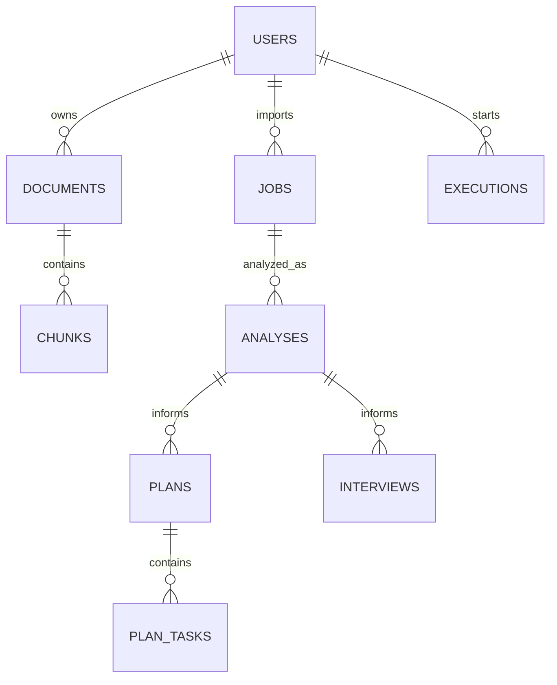

# CareerPilot 数据库设计

状态：v0.1 设计草案。负责人维护逻辑设计，组员 B 实现应用集合与索引，C 实现片段及向量映射。当前未创建生产数据库。

## 通用约定

- MongoDB 保存权威业务数据，向量存储保存可重建的检索索引。
- 对外 ID 使用不可预测的字符串；内部表示由实现统一，禁止前后端混用 ObjectId 和任意字符串。
- 时间使用 UTC，API 为 ISO 8601；计划保留用户 timezone，默认 Asia/Shanghai。
- 私有记录包含 user_id、created_at、updated_at；同一请求中的关联 ID 均验证属于当前用户。
- 对外字段统一 snake_case。所有新增字段先更新此文档和 API 契约。

## 关系



## 集合与主要字段

| 集合 | 主要字段 | 约束 |
| --- | --- | --- |
| users | id, email, password_hash, display_name, timezone | email 规范化后唯一；密码只存合适算法的哈希，不保存明文 |
| documents | id, user_id, kind, filename, storage_key, media_type, size_bytes, current_version, status, deleted_at, purge_status | kind 为 resume/project；status 为 uploaded/processing/ready/failed/deleted；purge_status 跟踪物理清理 |
| document_versions | id, user_id, document_id, version, extracted_text_key, content_hash, parser_version, embedding_model, status | 每次修改创建新版本；原文对象版本化；document_id + version 唯一 |
| chunks | id, user_id, corpus, document_id, version, text, locator, vector_id, source_url, deleted_at | corpus 为 personal/public；个人片段必须有 user_id；公共片段必须标记来源 |
| jobs | id, user_id, title, company, raw_jd, requirements, version | requirements 数组含稳定 id、text、category；category 为 required/preferred；文本原文保留 |
| analyses | id, user_id, job_id, job_version, document_versions, matches, warnings, stale, trace_id, prompt_version | matches 含 requirement_id、status、evidence_refs、explanation、missing_information |
| plans | id, user_id, analysis_id, deadline, timezone, daily_minutes, status, draft_tasks, confirmed_at | status 为 draft/confirmed；draft_tasks 不直接成为正式 plan_tasks |
| plan_tasks | id, user_id, plan_id, title, requirement_ids, scheduled_date, estimated_minutes, status, source_refs | status 为 todo/in_progress/done；scheduled_date 按计划时区解释 |
| interviews | id, user_id, analysis_id, status, turns, feedback, prompt_version | turns 含角色、文本、时间及问题编号；限制轮数和单轮长度 |
| executions | id, user_id, type, resource_id, status, attempts, worker_id, lease_until, result_id, error, trace_id | type 为 index/analysis/plan；任务领取原子化；错误不得含密钥或简历全文 |
| execution_events | id, user_id, execution_id, tool_name, status, duration_ms, evidence_ids, usage_summary | 仅业务可观测事件；不存隐藏推理过程或敏感输入全文 |

上述集合均适用通用 ID 与时间字段。document_versions 中的 extracted_text_key 指向私有对象；不把大型文件正文塞入 users 等主业务集合。

## 关键结构

```json
{
  "requirement_id": "req_01",
  "status": "partial",
  "evidence_refs": [
    {"document_id": "doc_demo", "version": 1, "chunk_id": "chunk_demo"}
  ],
  "explanation": "资料体现数据库设计，尚未体现性能优化实践。",
  "missing_information": ["是否做过查询性能分析？"]
}
```

匹配状态为 supported/partial/not_evidenced。not_evidenced 表示资料未体现，不等于用户不具备能力。

locator 示例：`{"kind":"pdf","page":2}` 或 `{"kind":"text","line_start":10,"line_end":18}`。只有实际解析获得的位置才能写入。

## 索引初稿

| 集合 | 索引 | 用途 |
| --- | --- | --- |
| users | email 唯一 | 登录唯一性 |
| documents | user_id, deleted_at, created_at | 个人资料列表 |
| document_versions | document_id, version 唯一 | 避免重复版本 |
| chunks | corpus, user_id, document_id, version | 来源查找、版本过滤和删除 |
| jobs | user_id, created_at | 岗位列表 |
| analyses | user_id, job_id, created_at | 分析历史 |
| plan_tasks | plan_id, id 唯一 | 确认计划时使用稳定任务 ID 幂等写入 |
| interviews | user_id, created_at | 面试历史 |
| executions | status, lease_until, created_at | Worker 领取及恢复任务 |
| execution_events | execution_id, created_at | 执行事件查询 |

向量索引 payload 至少包含 corpus、user_id、document_id、version、chunk_id、deleted 标志。检索前验证文档仍可访问；向量过滤与 MongoDB 校验共同生效。

## 生命周期与一致性

1. 新版本只有全部入库成功后才切换 current_version；旧版不参与默认检索。
2. 资料更新或 JD 修改后，将相关分析标记 stale；用户可查看旧版说明并重新分析。
3. 删除先写 deleted_at 并阻断资料与引用访问，再异步删除对象、片段及向量；purge_status 可观察，失败可重试。
4. 计划确认使用 MongoDB 事务，在同一事务中创建稳定 ID 的 plan_tasks 并标记 confirmed；托管实例需支持事务。重复请求返回同一计划及任务，不重复创建。
5. 跨 MongoDB、文件和向量存储的操作使用可重试的持久化任务，不假设跨系统事务。
6. 备份、保留时长和用户注销清理策略由负责人在上线前确认并写入部署配置。

## 设计变更

新增集合、索引、删除方式和嵌入维度变更须关联 Issue，说明迁移、旧数据兼容与回滚。普通模块 PR 不得自行修改公共 Schema。
