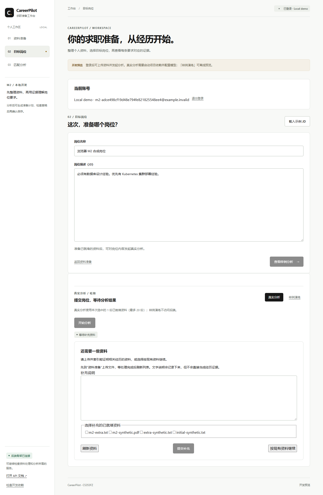
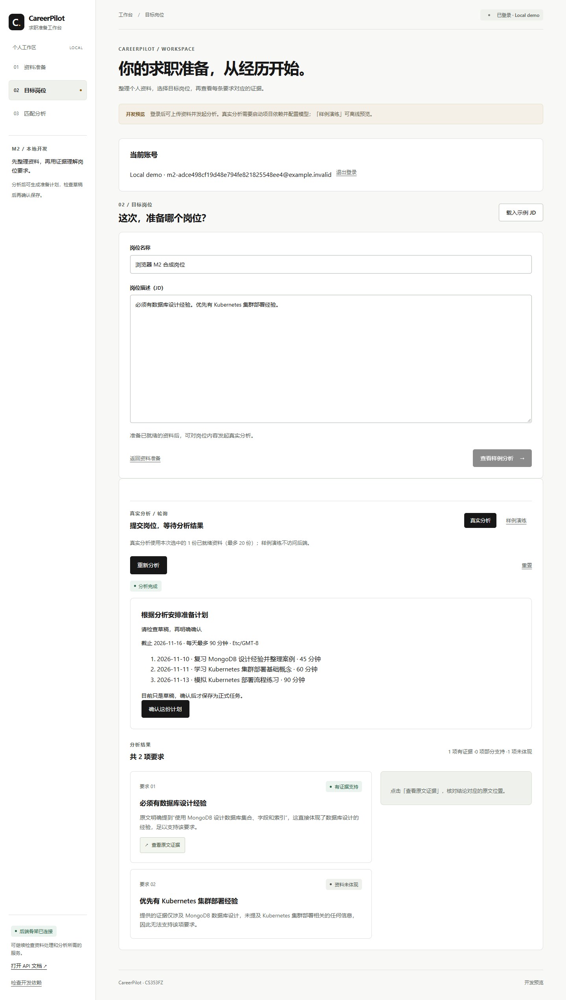
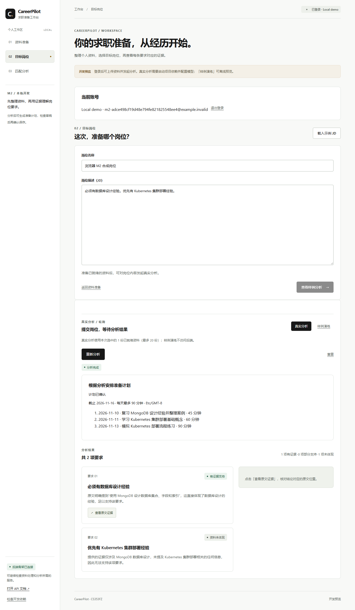

# M2/D 冯威：Agent 交付与真实验收

执行日期：2026-11-09。关联 #26，依赖 B 的 PR #28。此分支保留 B 原提交历史并在本地集成；不代表 #28 已进入远程 main。最终合并须由其他成员审查。

## 用户现在能做什么

上传 PDF/TXT/Markdown 后发起真实分析。证据不足时页面显示追问，可以补说明、上传并选择新资料，或明确按现有资料继续。暂停会结束本次 Worker 调用，重启后从保存的阶段快照恢复。文字说明不会变成经历证据；新增资料必须重新通过后端归属、就绪及版本检查，再由真实检索提供原文。

分析完成后填写截止日期、时区和每天可用分钟数，生成准备计划草稿。每天总工时、日期和引用由代码检查。明确确认前不创建正式任务；重复确认返回相同任务 ID，不再调用模型生成。网页刷新可恢复追问、分析结果和计划草稿。

## 模块与边界

- D：`agent/plan.py` 生成及校验草稿；`agent/clarification.py` 执行追问与累计预算；`agent/checkpoints.py` 保存用户/执行绑定的 SQLite 阶段快照；`agent/resume.py` 提供 B 约定的恢复入口。
- B 接线：`services/agent_bridge.py` 复核资料和已保存输入，恢复完成后才保存权威分析结果；`worker.py` 负责运行、等待和终态。`save_analysis_result` 用原钉版守卫写入新钉版，避免把未保存结果报告为成功。
- B 的输入幂等修复：写入和重放使用同一份含文档版本的哈希；重放还检查 checkpoint。恢复投递前在 MongoDB 事务内检查原分析、岗位及资料版本，执行前后再检查来源。
- 前端：补充资料、明确继续、生成草稿、确认计划，以及刷新后的恢复。未扩展 M3 任务看板或面试功能。
- 删除同步：资料 purge 同时使相关 D 快照失效并移除原文/派生草稿；运行中再次写回会被拒绝。

## 持久化与预算

这里采用真实 LangGraph 分析图加应用级阶段快照，不是 LangGraph 原生 checkpointer 插件。保存的边界是“分析完成等待资料”和“草稿完成等待确认”；实测能在这些暂停点重启并继续。模型调用正中途崩溃时保守失败，不自动重复计费或承诺任意节点续跑。

快照在 `LOCAL_STORAGE_DIR/agent/checkpoints.sqlite3`，与私有开发数据一起备份/清理，不能提交。当前适用于单机或同一私有存储上的单机 Worker；多台机器不能各用独立本地盘当共享快照库。MongoDB 仍是对外业务权威。正式部署的共享 checkpoint 适配器属于部署验证事项。

默认跨追问累计最多预留 12 次模型 HTTP 请求、8 次检索、180 秒活动预算和 3 轮补充；等待用户的时间不计入模型/工具活动时间。请求按最大重试次数保守预留，进程崩溃保留预留额度，恢复不会清零。次数用完仍可明确按现有资料结束分析。

## 实际检查结果

- 完整后端：**464 passed，无跳过**，119.07 秒。启用真实 MongoDB 登录、岗位、资料存储和 M2 副本集事务检查；模型单元测试仍明确使用替身。
- Ruff 全库检查、格式检查通过；前端 TypeScript/Vite 构建和 Prettier 检查通过；重新导出 OpenAPI 并生成前端类型。
- 真实验收：Windows API/Celery 与独立 WSL Ubuntu 24.04 环境中的 MongoDB 8.0.16 副本集、Redis 7.0.15、Qdrant 1.19.2；百炼真实 Embedding 和 `qwen3.7-plus`。仅使用随机隔离账号、隔离数据库/向量集合与合成资料。
- Docker Desktop 因既有损坏通信文件无法启动。本次另建 `CareerPilotM2` 隔离环境绕开故障，未重置 Docker、删除其数据卷或覆盖原 .env。只对同一百炼 HTTPS 服务复用本机已有密钥完成 Embedding 验证，未将密钥写入提交。

| 验收 | 结果 |
| --- | --- |
| 真实上传、索引、检索与模型分析 | PDF、文本均可入库；引用能返回原文 |
| 证据不足暂停并释放 Worker | 实际进入 waiting_for_input |
| 暂停后终止并重启 Worker | 重启后可以提交回答并继续 |
| 只补自由文本 | 保持无证据结论并继续等待，不冒充经历 |
| 补充真实资料 | 重新检索，分析成功并保存新增资料钉版 |
| 按现有资料继续 | 保留资料未体现的判断，完成并保存分析 |
| 计划草稿与确认 | 确认前无正式任务，确认后恢复成功 |
| 重复回答/确认 | 不重复生成或产生额外正式任务 |
| 错误用户、旧 checkpoint、冲突回答 | 拒绝读取或恢复 |
| 数字 1 代替明确继续 | 422 拒绝，不自动当作布尔确认 |
| 来源更新后的草稿确认 | 409 拒绝，未创建正式任务，原分析显示 stale |
| 来源删除后的恢复 | 409 拒绝；相关 Agent 快照原文已移除 |
| 浏览器刷新 | 追问、结果、计划草稿都可恢复 |

截图来自真实浏览器、真实 API/Worker/模型，不是模拟接口截图：





脱敏的逐项结果见 [API](acceptance/2026-11-09-m2-api.json)、[PDF](acceptance/2026-11-09-m2-pdf.json)、[错误场景](acceptance/2026-11-09-m2-negative.json)、[浏览器](acceptance/2026-11-09-m2-browser.json)。这些合成案例证明流程，不证明总体模型准确率。

## 复现

按 09/12 文档配置并启动真实服务，MongoDB 必须启用副本集。保持原始密钥只在本机。启动 API、Celery Worker、前端，准备两个相互隔离的本地种子账号。前端使用业务 API 即可完成上述交互。

```powershell
uv run --project backend pytest backend/tests -q
uv run --project backend ruff check --config backend/pyproject.toml backend/app backend/tests scripts
npm run format:check --prefix frontend
npm run build --prefix frontend
uv run --project backend python scripts/m2_acceptance.py --base-url http://127.0.0.1:8000 --include-lifecycle-checks
```

验收脚本使用 `M2_USER_EMAIL/M2_USER_PASSWORD`、`M2_OTHER_EMAIL/M2_OTHER_PASSWORD`，未设置时在交互终端提示输入；密码不走命令行参数。会创建合成资料并调用真实模型，生命周期检查只更新/删除本次创建的合成文档。输出默认为 `storage/agent/m2-acceptance.json`。如需在暂停点验证 Worker 重启，可用 `M2Audit.run(..., on_pause=...)` 注入受控的服务重启回调；本机已实际执行 Worker 重启场景。

启用真实数据库自动检查时设置 `RUN_MONGO_AUTH_TESTS=1`、`RUN_MONGO_JOB_TESTS=1`、`RUN_MONGO_STORAGE_TESTS=1`、`RUN_MONGO_M2_TESTS=1`；这些检查使用专用测试数据库并清理各自数据，不能指向生产数据库。

AI 使用：Codex 辅助实现、接线、执行检查及整理文档。B 原提交保留作者归属；负责人和成员仍需审查代码与以上限制，不把团队代码全部算作 D 的个人贡献。
