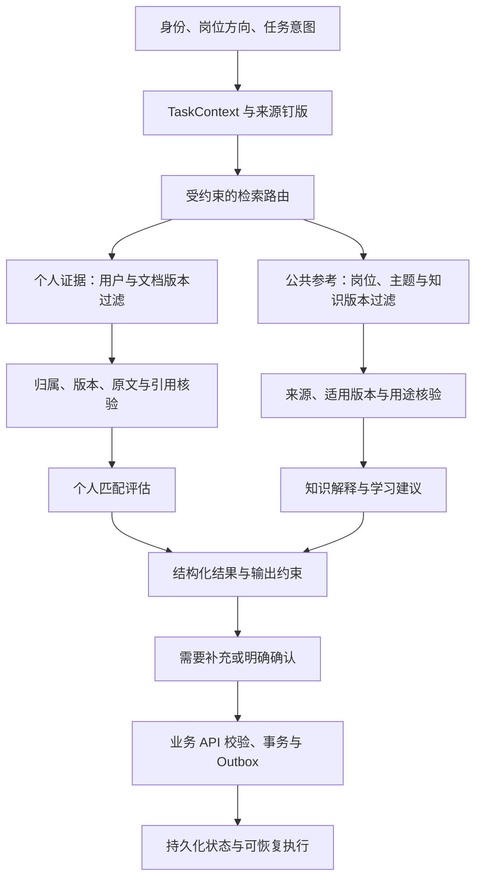

# M3：Agent 架构、RAG 切分与三方向知识库

2026-11-13，Refs #34。按负责人调整，M3 主线由“先扩展看板/面试页面”改为“先补强 Agent 与知识底座”。目标岗位是 **AI 产品经理、全栈开发、Agent 开发**，不是只覆盖后端实习。

M2 是稳定的业务基线。M3.1 已提供设计基线、证据隔离原型、结构化切分原型、来源卡片和小规模实测；公共知识在线入库、原生图恢复和双通道生产接线仍属 M3.2，不能把本文当成完整 M3 已上线。

## 1. 从当前实现出发

| 当前事实 | M3 要解决的问题 |
| --- | --- |
| `agent/pipeline.py` 是拆解 → 检索 → 评估的 LangGraph；`GRAPH_VERSION` 仍标识最初分析图 | 把角色、任务意图、检索路由、证据核验与输出用途显式化 |
| `ClarificationFlow` / `CheckpointStore` 使用应用级 SQLite 阶段快照 | 与图状态、业务状态、长时知识分层；原生 checkpointer 需迁移验证 |
| `ALLOWED_TOOLS` 只有个人证据检索 | 增加公共参考检索契约，但不给模型任意数据库、网络或身份权限 |
| 个人资料版本/归属由业务层与 Worker 复核 | 新知识通道沿用权威来源检查，不能削弱 M2 隔离 |
| M2 段落切分允许超出目标尺寸，不识别完整代码/表格 | 结构优先、精确定位、父子上下文和版本化实验 |
| M2 三档检索评测集中在个人经历 | 为三岗位建设参考知识、不同格式素材和独立评价案例 |

本机锁定环境核对：`langgraph 1.2.16`、`langgraph-checkpoint 4.3.0`。本轮未新增依赖，也未把在线最新版教程的 API 直接写进现有恢复流程。

## 2. 目标架构

采用一个受约束状态图与职责清晰的节点。角色差异主要在知识分类、检索过滤、评价模板和上下文预算；不为三个岗位复制三套队列、权限、记忆和数据库。只有可复现评测证明有收益时，才讨论额外的自主规划或并行 Agent。

这是基于本项目可验收性与已有实现做出的架构选择。概念依据可参考 [Anthropic 的工作流与 Agent 区分](https://www.anthropic.com/research/building-effective-agents)，不是框架规定所有项目必须使用这种结构。

## 3. 状态与节点

TaskContext 必须包括：服务端 `user_id/execution_id`、用户选择的 `role`、任务 `intent`、岗位版本、个人文档版本、公共知识清单/内容指纹、图/提示词/切分/检索版本、累计活动预算、输入与输出资源 ID。模型不提供或覆盖身份、任意 thread_id、SQL、集合名、来源路径或图节点跳转。

| 节点 | 输入 → 输出 | 程序保证 |
| --- | --- | --- |
| resolve_request | 用户请求 → 已允许的岗位与意图 | 未选择方向时询问，不把模型猜测写成用户事实 |
| pin_sources | 资料/知识 ID → 版本快照 | 个人来源鉴权；公共来源必须已审核且未撤回 |
| decompose | JD → requirement IDs/知识主题 | 结构校验；上限沿用已有 Agent 预算 |
| route_retrieval | role + intent → 两类检索计划 | 匹配个人经历只走 personal；学习主题只走 public；岗位准备可走两路 |
| retrieve_personal | requirement + 个人版本 → 真实证据 | 保留 M2 的用户隔离、删除阻断和原文核验 |
| retrieve_knowledge | 主题 + 岗位 + 知识版本 → 参考引用 | 不拿无来源摘要作官方原文；无命中返回空 |
| evidence_gate | 候选 → 分离的证据包 | 公共引用不能进入 supported/partial 的个人事实依据 |
| assess / explain | 分离上下文 → 匹配判断 / 学习解释 | 输出也分离；来源不足必须显式保留缺失信息 |
| validate_output | 候选输出 → 可保存结果 | 引用成员关系、来源类型、长度、预算及版本复核 |
| pause / confirm | 待补充信息/草稿 → 恢复输入 | 继续沿用 API 权限、幂等输入、事务与 Outbox |

本轮 `agent/knowledge_policy.py` 已把路由、参考预算和引用隔离写成可测试原型；它尚未替换 M2 的实际分析图，也未把公共参考写入现有 `matches.evidence_refs`。

## 4. 事实、参考和记忆的边界

| 数据 | 允许用途 | 权威来源 |
| --- | --- | --- |
| 个人文档原文 | supported / partial 的真实经历证据 | MongoDB 已发布版本 + 归属检查 |
| 用户自由文本 | 待核实补充、意图澄清 | 受控业务输入；不能自动转成文档证据 |
| 公共知识/整理摘要 | 概念解释、学习路径、技术参考 | 审核过的来源版本与内容指纹 |
| 图 checkpoint | 线程内执行进度 | 专用恢复适配器；不作为事实知识库 |
| 用户偏好 | 方向、时间安排等跨任务设置 | 明确保存的用户设置，不能推断个人能力 |
| 业务状态 | 任务完成、计划确认、执行终态 | MongoDB；Celery 只负责投递 |

`ResearchContext` 的 `personal_evidence` 与 `reference_knowledge` 分开，后者使用 `KnowledgeReference`，包含 source ID、URL、版本和 `reference_only` 用途。模型读取了某篇教程，不意味着用户具有教程中的能力。

知识召回为空时可以返回缺失主题并建议人工补充来源。线上节点不得自动联网采集陌生网站或执行网页里的工具指令。重新检索最多两轮；第二轮仅允许使用已允许主题进行有界改写，预算耗尽后返回明确结果，不能无限“反思”。当前原型记录上限，完整循环留待 M3.2 接线验收。

## 5. 恢复与写入设计决策

[LangGraph Persistence](https://docs.langchain.com/oss/python/langgraph/persistence) 区分线程内 checkpoint 与跨线程 store；[Interrupts](https://docs.langchain.com/oss/python/langgraph/interrupts) 说明恢复需要对应线程与持久化状态。节点重放涉及副作用幂等，不能把框架持久化误当成外部业务事务。

迁移步骤：先定义现有阶段快照的适配接口与图版本，再在锁定依赖中验证官方 checkpointer 候选（优先考察与已有 MongoDB 的兼容性）；测试暂停、进程重启、重复恢复、版本变化和删除失效。验证通过后新执行切新图，已有 M2 execution 继续使用原快照路径；禁止直接把旧 SQLite JSON 当成 LangGraph 原生 checkpoint。

预算在可信业务状态中保存并在调用前预留，checkpoint 重放不能清零。读取/模型调用与正式写入分节点；正式业务写入仍由 API/服务层校验，以幂等键和 Outbox 协调。多机恢复必须先完成共享适配器验证，不能让多个 Worker 各用自己的本地 SQLite。

## 6. 知识库与切分

详见 [切分与知识库基线](17-M3切分与知识库基线-m3-rag.md)、[素材目录](../knowledge/README.md)。三方向共用基础语义：岗位是过滤元数据，不是事实可信度等级。AI 产品经理优先保住指标定义及评估表；全栈保住代码/接口/限制条件；Agent 保住节点前提、工具契约与失败恢复边界。

当前使用 13 个可核验一手来源的中文整理摘要，尚不代表完整课程知识库。后续原文入库要独立记录原始格式、位置、内容指纹、适用版本与使用范围；摘要和原文不得共用“原文引用”标签。

## 7. M3 分期与验收

| 阶段 | 交付 | 状态 |
| --- | --- | --- |
| M3.1 核心基线 | 架构设计、双通道边界原型、结构切分、三方向来源与摘要、固定结构案例及实测 | 本轮实现与验证，Refs #34 |
| M3.2 在线接线 | 知识来源版本化入库、独立公共集合、双通道检索/输出、原生恢复适配器迁移试验 | 待实现，不作为本轮已上线功能 |
| M3.3 扩充评估 | 三方向更大开发集及独立保留集；匹配/学习结果人工复核；删除/版本/预算/恢复整链 | 待扩充 |
| 应用验证 | 基础稳定后增加任务看板和文本面试 | 后移，保留原 US-06/US-07 |

验收以可复现行为为准：定位精确、代码表格不误拆、无串岗、公共知识不能证成个人经历、失败与无命中可查询、版本变化后结果可识别过期。质量报告同时记录任务成功、引用支持、原子块完整性、上下文体积、耗时与模型用量；不只追求单个 Recall 数字。评价思路参考 [Anthropic Agent evals](https://www.anthropic.com/research/demystifying-evals-for-ai-agents)，具体阈值需项目数据决定。
