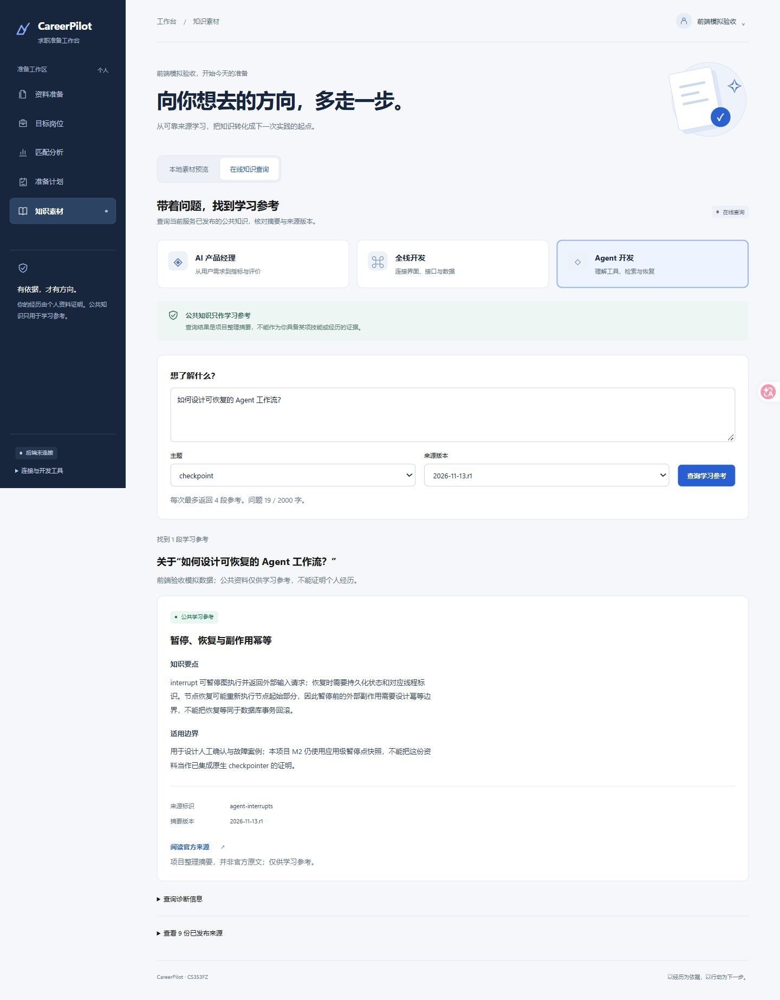
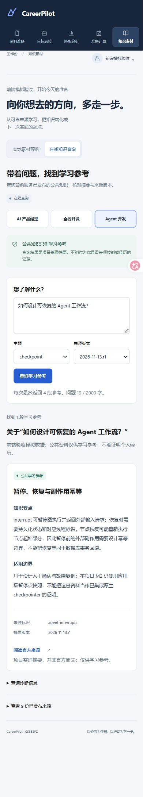

# 前端 M3.2：在线知识查询消费端

2026-11-20，Refs #43；增量提交至 PR #38，依赖后端 PR #42（尚未合并）。

## 交付与边界

“知识素材”新增“本地素材预览 / 在线知识查询”切换。默认本地预览保持免登录；在线模式使用现有工作区账号，通过业务 API 读取已发布目录与查询公共引用，不直连 Mongo/Qdrant，不把目录或本地摘要冒充检索结果。

- 三岗位方向独立查询，可按主题和来源版本筛选；问题去除首尾空白，最多 2000 字，固定 `top_k=4`、`max_chars=6000`。
- 展示摘要正文、知识要点与适用边界标题、来源标识、摘要版本、官方链接；目录展示核验日期。仅允许 HTTP/HTTPS 来源链接，不渲染服务端 HTML。
- 公共参考始终独立于个人证据。拒绝用途不是 `reference_only`、内容类型不是 `editorial_summary` 或不属于当前岗位的引用；不写入分析证据或技能结论。
- 未登录、加载、空目录、空命中、404/501 未部署、网络/服务错误、30 秒超时与重试有独立反馈；401 复用应用登录过期流程。请求标识收在诊断信息中。
- `LatestRequest` 同时取消旧请求并检查当前请求身份；修改问题/筛选、切换岗位/模式、离开页面及账号变化后，旧响应不能更新当前结果。账号与岗位通过 React key 重建状态。

## 接口契约

依据 `origin/feat/41-knowledge-ingest` 的 `25ff5d4`：`backend/app/schemas/knowledge.py`、`app/rag/knowledge.py`、业务路由与服务实现。

| 接口 | 消费内容 |
| --- | --- |
| `GET /api/v1/knowledge/sources?role=` | `data.items`：id/title/url/roles/topics/version/verified_on/content_kind/usage |
| `POST /api/v1/knowledge/query` | role/query/top_k/max_chars/topics/source_version；`data.items` 为 KnowledgeReference，附 notice |
| 公共引用 | source_id/source_version/source_url/title/summary/roles/content_kind/usage |

复用现有 Bearer、业务 envelope、request_id 和会话失效事件。后端尚未进入 main，因此在 `frontend/src/api/m3-types.ts` 维护注明来源的临时消费端类型，不修改由后端导出的 OpenAPI 快照；#42 合并后应替换为生成类型并重新核对字段。

## 实际验证

以下检查通过：

```text
cd frontend
npm run typecheck
npm run build
npm run format:check
cd ..
node scripts/test_frontend_knowledge.mjs
node scripts/test_frontend_events.mjs
git diff --check
```

知识回归 6 项通过：真实客户端 URL/鉴权、查询过滤与预算、来源版本/文本与空结果、取消合并超时、旧响应乱序、当前/旧账号 401、未部署/503/错误 envelope。原 SSE 回归 3 项通过。知识回归已接入现有 frontend CI。最终构建 52 模块，CSS 33.81 kB、JS 324.16 kB；无新增 npm 依赖。沙箱内 Vite 子进程受限，获准在沙箱外构建通过。

浏览器使用 `scripts/mock_knowledge_api.mjs` 的**前端模拟接口**，以虚构邮箱和口令操作实际前端页面；模拟接口读取已有知识目录，返回固定示例，不实现语义检索，也不构成真实认证或后端联调。

| 手工场景 | 结果 |
| --- | --- |
| 未登录 → 页面登录入口 → 虚构账号登录 | 提示明确；登录后读取目录 |
| 岗位切换 | 目录 5/6/9；旧结果清除 |
| Agent + checkpoint + 2026-11-13.r1 | 返回 1 条模拟参考，展示版本与来源 |
| 无匹配 | 0 条，不补造引用 |
| 503 故障 | 显示错误并保留问题供重试 |
| 慢查询 → 取消 | 明确取消提示，旧响应不覆盖 |
| 慢查询 → 切全栈 → 新查询 | 全栈新结果保留 |
| 查询返回 401 | 清除会话，显示“登录已过期，请重新登录” |
| 空来源目录 | 不开放查询，显示重新读取入口 |
| 404 未部署 → 重试 | 明确功能未部署，仍可切回本地预览 |
| 桌面 1440×900 / 手机 391×844 | 无横向溢出；手机结果为单列；实际 DOM 尺寸确认，验收后恢复 viewport |

截图为模拟验收，账号名及结果提示均注明模拟；裁掉浏览器全页截图额外捕获的右侧/底部空白，不改变页面内容。





## 复现模拟验收

仅本机绑定 `127.0.0.1:9009`，不要作为正式服务部署。使用任意虚构邮箱和口令，勿输入真实账号凭据。PowerShell 分别运行：

```powershell
node scripts/mock_knowledge_api.mjs
```

```powershell
$env:VITE_API_PROXY_TARGET='http://127.0.0.1:9009'
cd frontend
npm run dev -- --port 5174
```

访问 `http://127.0.0.1:5174`，进入“知识素材 → 在线知识查询”。问题包含“无匹配 / 故障 / 慢查询 / 过期”触发对应状态；模拟服务启动参数 `empty-catalog` 或 `undeployed` 分别复现空目录、404。

## 待联调

- #42 合并并启动真实鉴权、Mongo、Qdrant、embedding provider，发布知识后验证查询、版本过滤与撤回不可见；本次未运行该端到端链路。
- #39 提供最终 Agent 双通道输出后，接入分析/准备流程中的学习参考区域。本次不包含此部分，也不宣称 M3 全部完成。
- #43 保持 Refs，待真实联调后再判断能否关闭；PR 仍需另一位成员审查。

Codex 辅助实现、测试及验收，视觉延续 frontend-design skill 指导下的现有工作台风格。保留用户未跟踪的个人汇报文件，不提交任何真实用户资料或凭据。
