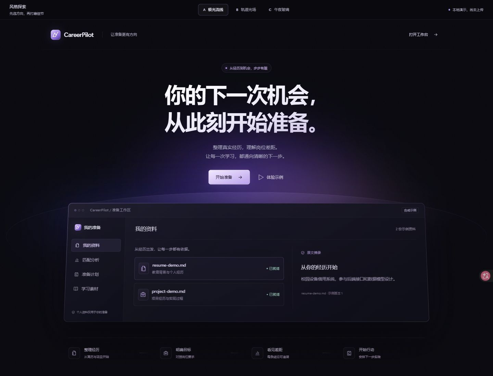
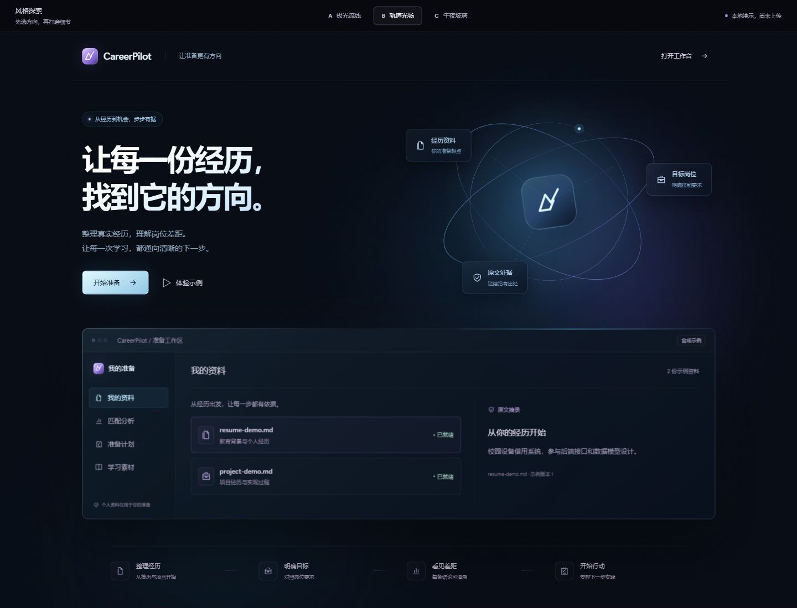
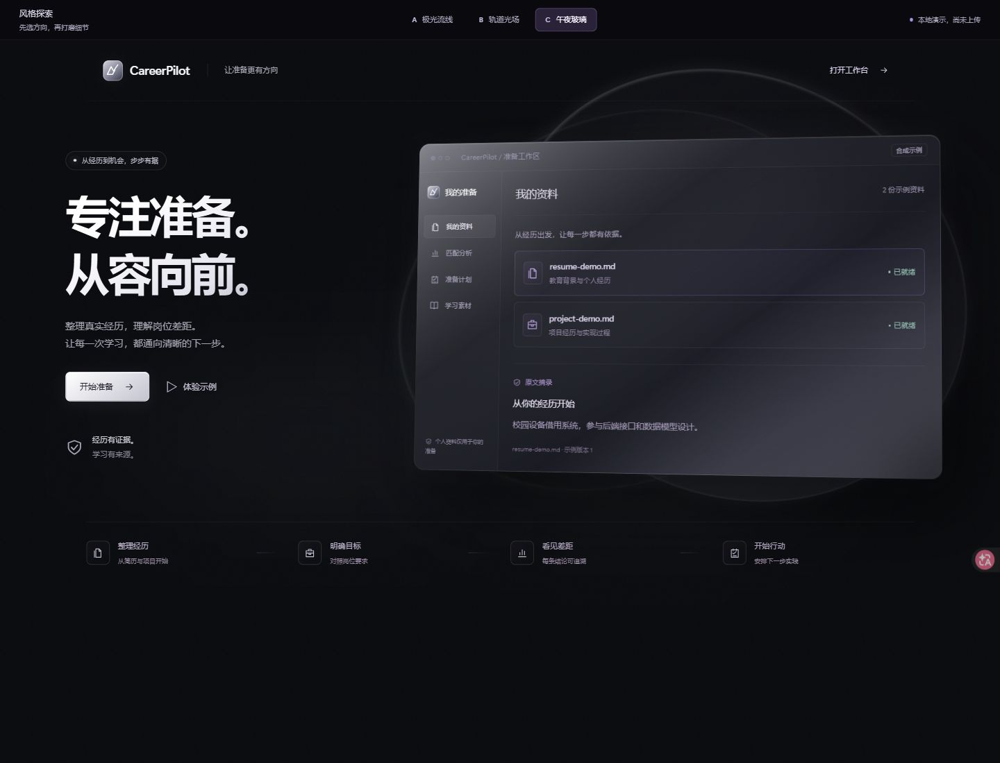
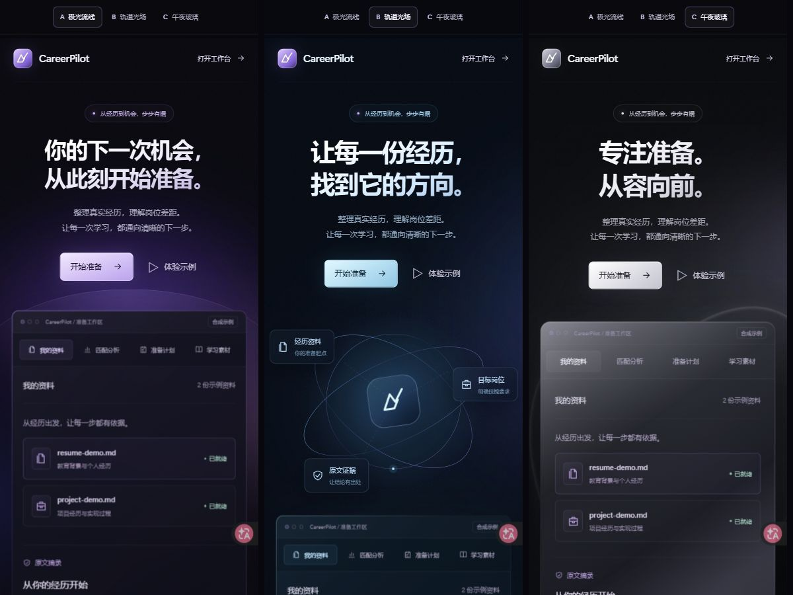

# 前端视觉方向探索

2026-11-22，Refs #37。依据用户补充的小组任务：寻找优质设计 skill 和 Linear / Apple 风格，裁剪冗余按钮与提示。用户先选方向，再精修；不提交、推送或更新 PR。

已阅读参考：[Micoxx：设计师必懂，什么是 Linear 风设计？](https://zhuanlan.zhihu.com/p/622086961)。重点是多层渐变融合、模糊与蒙版、代码实现微噪点、细描边、局部外发光、克制的边缘流光。文章同时强调性能与实用性，不能以堆砌视效代替产品价值。

继续使用已安装的 frontend-design skill。以下方案为原创代码演示，借鉴参考的构成方式，不复制文章图片或整站模板。

## 设计方案（实现前）

| 方向 | 六个主要颜色 | 排版与构成 | 记忆点 |
| --- | --- | --- | --- |
| A 极光流线 | #07070d / #14131e / #e8e6f8 / #8d7cff / #d69bff / #343045 | 居中标题、大面积暗色留白、下方悬浮的工作区预览；正文左对齐 | 紫色光晕从产品后方展开，边缘短时流光 |
| B 轨道光场 | #040912 / #101c2b / #e8f4ff / #64cbff / #8b7bff / #213952 | 左侧标题与主要操作，右侧 SVG 轨道主视觉，下方横向流程 | 轨道连接资料、岗位与证据，微光点沿路径移动 |
| C 午夜玻璃 | #08090c / #22242a / #f4f4f6 / #c9cdd8 / #9b99c8 / #3b3d45 | 左侧短标题、右侧大块玻璃工作区；银灰配色，结构更接近应用 | 多层磨砂与银白边缘反射，交互时轻微浮起 |

字体为系统无衬线 Segoe UI Variable / Segoe UI，中文回退 Microsoft YaHei / PingFang SC；标题约 48–64px，正文 14–16px，产品预览 12–14px。用渐变覆盖整个标题，不做单词装饰。

```text
A：顶栏 → 居中主标题 → 两个行动入口 → 光场中的工作区预览
B：顶栏 → 左侧文案 / 右侧轨道 → 横向准备路径 → 参考详情
C：顶栏 → 左侧文案 / 右侧磨砂工作区 → 底部轻量进度
```

自审：三版应在光源形态、布局和面板材质上有可比较的差异，不能只是换色。流光集中在主视觉区域，背景低透明度噪点不能遮挡正文；reduced-motion 下禁用自动动画。桌面与手机都保留一个明确的主要操作。

## 内容裁剪原则

演示只保留“开始准备”和次要“体验示例”。登录放在导航一处；文件格式、数据边界等必要说明放到操作上下文。资料、岗位、分析、计划通过一条路径组织，不在首页重复放多组相同导航。开发依赖、API 状态和重复的宣传提示不占演示首屏。

演示数据明确为合成示例。选定风格之前，演示不代替正式登录、上传或分析功能；按钮提供本地演示交互，不调用真实后端。

## 实现与演示入口

- [A 极光流线](http://127.0.0.1:5174/?design=aurora)
- [B 轨道光场](http://127.0.0.1:5174/?design=orbital)
- [C 午夜玻璃](http://127.0.0.1:5174/?design=glass)

顶部按钮可直接切换三个方向，URL 保留当前选择；“开始准备”定位资料预览，“体验示例”展示既有合成契约的匹配分析。预览内可切换资料、分析、计划和学习素材；计划确认明确提示未创建后端任务。

CSS、SVG 都是本地代码：径向渐变与模糊叠加光场，蒙版限制光晕范围；1px 流光在面板边缘短时掠过；B 方案的 SVG 光点沿轨道旋转；C 方案采用 35px 背景模糊与半透明渐变玻璃。微噪点由小尺寸、可平铺的 SVG 生成，没有新图片依赖或 npm 依赖。`prefers-reduced-motion` 下停用自动动效。

方案入口独立于默认工作台，选定后再将所选视觉语言接回正式业务页面。上轮工作台改动仍留在本地，未被推送。

## 实际验证

`npm run typecheck`、`npm run format:check`、`npm run build` 与 `git diff --check` 通过。未新增仅镜像演示实现的测试。

浏览器实际检查：三方案切换、URL 同步、开始准备/体验示例、资料原文切换、键盘进入学习素材、示例计划确认正常。原文摘录来自仓库已有合成简历与证据 fixture；示例分析复用现有 `analysis-response.json`，不生成百分比或录用预测。

三版均在 1440×1100、约 391×844 和 320px 窄屏检查，无横向溢出。核对到面板计算样式为 `blur(28px)` / `blur(35px) saturate(1.2)`、微噪点透明度 0.038、边缘流光动画名称正确；两次读取轨道光点的旋转矩阵不同，确认 SVG 微动效在运行。减少动态效果的降级规则通过源码核对，未修改用户系统设置。

截图存于 `dev/acceptance/design-directions/`，来自实际演示页面。桌面截图统一裁去浏览器捕获范围额外的右侧/底部空白，保持 1440×1100；不改变产品内容。手机对比图是三张实际手机截图的上部并排组合，用于选择方向。









当前阶段待用户选择方向或指定组合；尚未提交、上传或更新 PR。
