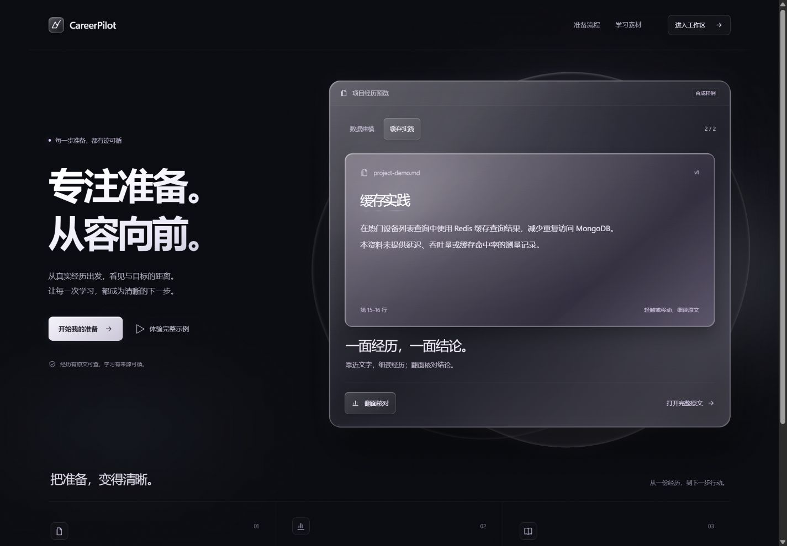
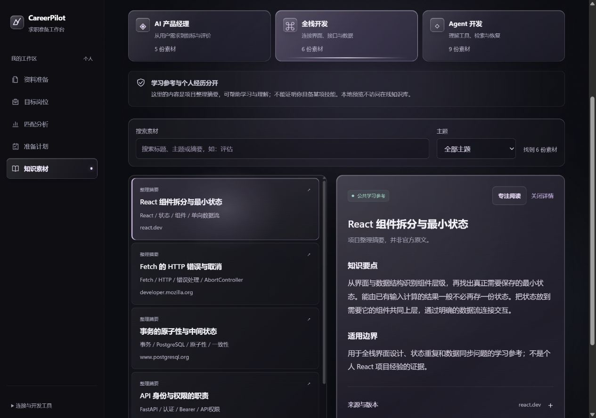
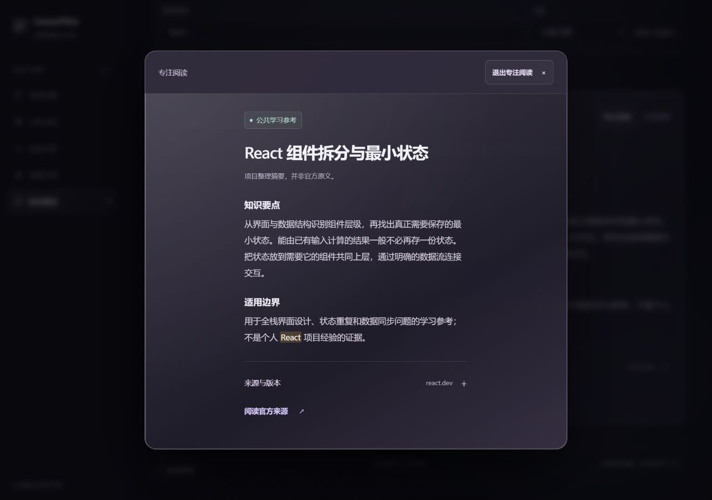
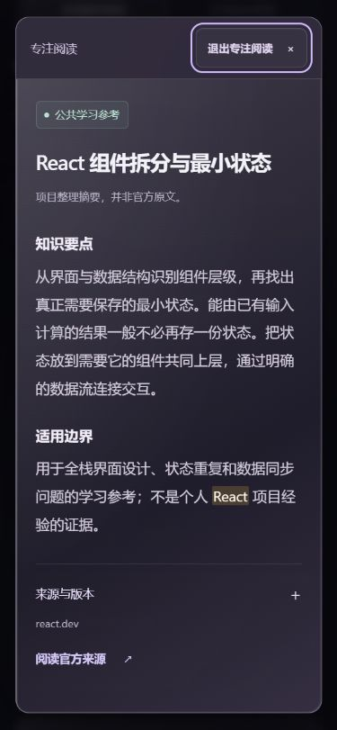

# 前端玻璃交互提交验收

2026-11-23，用户确认当前效果后授权提交上传。工作分支 feat/36-m3-knowledge-preview，更新已有 PR #38，base main。Refs #36、#37、#43。

## 本轮交付

- 正式玻璃首页与五步工作区，明确返回首页入口、历史导航、共享柔光；开发环境保留三种设计方向预览，生产入口不加载对比页面。
- 首页双面核对与逐字 Dock 反馈，中文逐字独立、组合字素完整，键盘操作与减少动态效果处理。
- 知识方向卡倾斜、定向反光、点击回弹与移动银光；本地 / 在线共享选择控件。
- 素材列表与详情联动、可取消筛选标签与字面搜索高亮、紧凑来源版本区、可退出的专注阅读弹层。
- 按账号隔离的会话阅读记忆，恢复方向 / 搜索 / 素材 / 列表和页面位置；键盘焦点与窄屏返回入口完善。
- 上传 / 解析 / 原地重试与完成反馈、资料列表刷新；修复切页期间滞后失败快照覆盖解析重试执行的问题。
- 分析前置条件与跳转入口、结论和版本证据联动、旧请求取消与乱序隔离；保存岗位成功反馈不提前伪造。
- 调整正文与辅助信息字号，提供轻量效果设置；登录过期导航按最新 URL 判断，避免旧事件回调保留错误步骤。

## 最后检查

- 已确认 #37 指派 KrissirK777；#36 / #43 同属当前前端工作。已有 PR #38 为 open，base main、当前分支 head；提交前没有待处理 review / inline discussion。
- `git fetch origin main` 与 `git merge origin/main --no-commit --no-ff`：Already up to date；main 已为当前分支祖先，无冲突。
- frontend：`npm run typecheck`、`npm run build`、`npm run format:check` 通过。
- `node --test scripts/test_frontend_workspace.mjs scripts/test_frontend_knowledge.mjs scripts/test_frontend_events.mjs`：20 项通过。工作区回归已接入 frontend CI。
- `git diff --check` 通过；仅逐项暂存源代码、测试、设计与验收材料，不提交用户个人汇报、构建产物、缓存、真实资料或凭据。
- 浏览器验收涵盖首页、正反面逐字反馈、知识筛选 / 阅读 / 来源 / 进度恢复、历史前进后退、轻量效果、键盘焦点、1280px / 375px / 320px 布局。详见 26–29 号记录。
- 保存 / 上传 / 失败重试通过隔离的本地合成 API 验证，主预览端口 5174 未改为模拟服务；模拟服务验收后已关闭。

## 已知边界

- 真实鉴权、Mongo / Qdrant、知识发布与撤回的端到端联调未在本轮完成，#43 保持 Refs；前端验收不等于整体 M3 完成。
- 没有真实手机硬件、屏幕阅读器或精确 GPU/FPS 测量；系统减少动态效果仅检查实现，未切换用户系统设置。
- 当前无新增阻塞前端预览 / 审查的问题；CI 与其他成员审查仍以推送后的实际结果为准，不自动合并。

## 效果截图

## 兼容性与 AI 辅助

无后端 API、数据库或 npm 依赖变更；沿用现有 React / Vite 与接口契约。会话阅读记录与轻量设置均做版本标记，存储不可用时可继续阅读；公共知识仍仅供学习，不能作为个人经历证据。

Codex 辅助设计、实现、测试和本机浏览器核验，使用 frontend-design、ui-ux-pro-max、vercel-react-best-practices、systematic-debugging 方法；用户已多轮确认视觉和交互方向。代码按视觉、资料、分析、知识、应用接线、测试 / CI、文档模块拆分提交，合并前须由其他成员审查。
